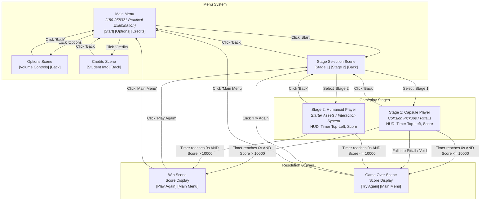

# Game Design Document (GDD)
## Course 958321: Game Development 3 — Practical Examination 1/2569
**College of Arts, Media and Technology (CAMT), Chiang Mai University**

---

## 1. Executive Summary & Vision

### 1.1 High-Concept
A 3D time-attack arcade collector game where players navigate structured 3D environments to gather positive score and time pickups while avoiding penalty obstacles and perilous pitfalls. The game tests player precision, route planning, and interaction across two distinct control mechanics: a physics-based **Capsule Player** stage and a third-person **Humanoid Character** stage.

### 1.2 Target Platform & Engine
- **Engine**: Unity 3D
- **Platform**: PC (Windows / Standalone)
- **Primary Input**: Keyboard & Mouse / Gamepad

### 1.3 Core Game Loop
1. **Selection**: Player launches from the **Main Menu**, configures audio in **Options**, and enters **Stage Selection**.
2. **Execution**: Player chooses **Stage 1 (Capsule Player)** or **Stage 2 (Humanoid Player)**.
3. **Challenge (Time Attack 30s)**:
   - A 30-second countdown begins immediately upon entering the stage.
   - The player traverses the level to collect items that award points and bonus time.
   - The player must avoid penalty items/obstacles that subtract score and deplete time.
   - In Stage 1, the player must navigate narrow ledges without falling into the void.
4. **Resolution**:
   - **Victory**: Timer reaches `0:00` with accumulated score **> 10,000 points**.
   - **Defeat**: Player falls off the stage boundaries, OR the timer reaches `0:00` with score **≤ 10,000 points**.

---

## 2. Core Mechanics & Game Systems

### 2.1 Time Attack System
- **Initial Duration**: 30 seconds (`00:30.00`).
- **HUD Placement**: Upper-left corner of the screen (`Top-Left HUD`).
- **Dynamic Clock Adjustments**:
  - Time increases when picking up Time Bonus items (+3s).
  - Time decreases when colliding with Time Penalty items/obstacles (-5s).
- **Termination**: Once the timer reaches `00:00.00`, the active stage terminates immediately and evaluates win/loss criteria.

### 2.2 Scoring & Win/Loss Rules

| Condition | Trigger | Result Scene | Notes |
| :--- | :--- | :--- | :--- |
| **Win** | Countdown reaches `0:00` **AND** Score `> 10,000` | **Win Scene** | Displays final score, "Play Again", and "Main Menu" options. |
| **Loss (Under Score)** | Countdown reaches `0:00` **AND** Score `≤ 10,000` | **Game Over Scene** | Displays final score, "Try Again", and "Main Menu" options. |
| **Loss (Pitfall / Void)** | Player falls below minimum Y-axis threshold | **Game Over Scene** | Immediate termination caused by falling off narrow ProBuilder paths. |

### 2.3 Collectibles & Obstacles Specification
The game features four distinct prefab entities distributed across the levels. Negative pickups and hazard elements represent the obstacle category:

```
                                  [Level Entities]
                                         |
                +------------------------+------------------------+
                |                                                 |
         [Positive Items]                               [Obstacles / Penalties]
         |              |                               |                     |
     [Time Boost]   [Score Boost]                 [Time Penalty]        [Score Penalty]
       (+3 sec)      (+500 pts)                      (-5 sec)             (-500 pts)
```

1. **Time Boost Item (+3s)**:
   - **Type**: Positive Collectible.
   - **Effect**: Adds `+3 seconds` to the active countdown clock.
   - **Audio**: Plays positive item pickup SFX.
   - **Lifecycle**: Consumed and removed from scene upon pickup.

2. **Score Boost Item (+500 pts)**:
   - **Type**: Positive Collectible.
   - **Effect**: Adds `+500 points` to the cumulative player score.
   - **Audio**: Plays positive item pickup SFX.
   - **Lifecycle**: Consumed and removed from scene upon pickup.

3. **Time Hazard / Obstacle (-5s)**:
   - **Type**: Negative Item / Hazard Obstacle.
   - **Effect**: Deducts `-5 seconds` from the countdown clock.
   - **Audio**: Plays obstacle collision SFX.
   - **Lifecycle**: Consumed on trigger or acts as persistent hazard.

4. **Score Penalty / Obstacle (-500 pts)**:
   - **Type**: Negative Item / Hazard Obstacle.
   - **Effect**: Deducts `-500 points` from the cumulative player score.
   - **Audio**: Plays obstacle collision SFX.
   - **Lifecycle**: Consumed on trigger or acts as persistent hazard.

5. **Killzone / Pitfall Obstacle**:
   - **Type**: Level Environment Hazard.
   - **Effect**: Triggers instant game defeat if the player drops below the playable boundaries.

---

## 3. Stages & Gameplay Design

### 3.1 Stage 1: Capsule Player (Time Attack Minigame)

- **Character Architecture**:
  - Primitive Capsule player controller configured with standard movement and physics.
  - Movement speed calibrated to allow traversing both wide and narrow walkways within 30 seconds.
- **Item Acquisition Mechanic**:
  - **Collision / Trigger-based Pickup**: Items and obstacles are collected automatically when the Capsule collider overlaps/collides with the item trigger.
- **Level Design (ProBuilder)**:
  - Designed using **Unity ProBuilder**.
  - Geometry features alternating **wide platforms** and **narrow bridges/catwalks**.
  - Deliberately unbordered sections where inaccurate movement causes the player to fall off into the abyss.
  - Sufficient items spawned so players collecting effectively can exceed the 10,000-point win threshold.
- **Heads-Up Display (HUD)**:
  - `Time Left`: Digital countdown timer pinned to top-left.
  - `Current Score`: Numeric score display.
  - `Scene Identifier`: UI text clearly displaying the scene name: *"Stage 1 - Capsule Player Minigame"*.
  - `Navigation`: Back button to return to previous menus.

---

### 3.2 Stage 2: Humanoid Player (Interaction Minigame)

- **Character Architecture**:
  - Humanoid 3D Character utilizing **Unity Starter Assets (Third Person Character Controller)**.
  - Third-person orbit camera, locomotion blend trees (Walk/Run/Idle), and grounded physics.
- **Item Acquisition Mechanic**:
  - **Explicit Interaction System**: Replaces simple contact collision with a dedicated interaction mechanic (e.g., proximity trigger with an interactive prompt / key press such as `[E]`).
  - Players must approach an item, receive visual/HUD prompt confirmation, and press the interaction input to gather it.
- **Level Design (ProBuilder)**:
  - Built with **Unity ProBuilder** covering a minimum playable surface area of **at least 50 square meters (≥ 50 m²)**.
  - Open arena / modular zone layout allowing free-roam third-person exploration.
  - Prefab item distribution strategically scattered to test movement and interaction speed under time pressure.
- **Heads-Up Display (HUD)**:
  - `Time Left`: Countdown timer pinned to top-left.
  - `Current Score`: Numeric score counter.
  - `Interaction Prompt`: Contextual prompt displayed when in range of interactable items (e.g., *"Press [E] to Collect"*).
  - `Scene Identifier`: UI text displaying *"Stage 2 - Humanoid Player Minigame"*.
  - `Navigation`: Back button to return to Stage Selection / Main Menu.

---

## 4. Scene Flow & User Interface Architecture

### 4.1 Scene List & UI Identification
Every scene in the build must display clear, prominent UI Text stating its scene identity:
1. `MainMenu`: Title, Start, Options, Credits buttons.
2. `StageSelection`: Stage 1 button, Stage 2 button, Back button.
3. `Stage1_Capsule`: HUD (Timer top-left, Score), gameplay canvas, Back button.
4. `Stage2_Humanoid`: HUD (Timer top-left, Score, Interaction prompt), gameplay canvas, Back button.
5. `Options`: Audio volume sliders (Master/BGM/SFX), Back button.
6. `Credits`: Student Name, Student ID, Course Title, Back button.
7. `Win`: Victory text, Final Score, Play Again button, Main Menu button.
8. `GameOver`: Defeat text, Final Score, Try Again button, Main Menu button.

---

### 4.2 Scene Navigation Graph (Fig. 1)



---

## 5. Audio & Sound Design

### 5.1 Background Music (BGM)
- **Continuous Ambience**: Background music plays persistently across all scenes (Menu, Options, Credits, Stage 1, Stage 2, Win, and Game Over).
- **Source Assets**: Selected from the course examination audio assets (`BGM` folder).

### 5.2 Sound Effects (SFX)
- **Item Collect SFX**: Plays immediately upon picking up positive items (+3s time boost, +500 points).
- **Obstacle / Hazard SFX**: Plays immediately upon colliding with negative items/obstacles (-5s time penalty, -500 points penalty).
- **Source Assets**: Selected from the course examination audio assets (`SFX` folder).

### 5.3 Audio Volume Control (Options Scene)
- The **Options Scene** must provide responsive audio volume controls (sliders/toggles) that reliably regulate:
  1. **Music Volume (BGM)**
  2. **Sound Effects Volume (SFX)**
- Audio settings must take effect across all gameplay stages and UI screens.

---

## 6. Level Design & ProBuilder Specifications

### 6.1 Stage 1 Metrics
- **Tool**: ProBuilder.
- **Topography**: Elevated walkways, open chasms, variable corridor widths (wide sections transitioning into narrow beams).
- **Hazard Zones**: Unprotected edges where accidental movement results in dropping into the killzone below.
- **Item Placements**: 
  - Risk/reward distribution: High-value positive items (+500 pts, +3s) placed near narrow or perilous edges.
  - Negative items (-500 pts, -5s) placed along natural paths to enforce player evasion.
  - Total positive items must sum to well over 10,000 points to make the win condition achievable within 30 seconds plus earned bonuses.

### 6.2 Stage 2 Metrics
- **Tool**: ProBuilder.
- **Minimum Footprint**: Playable area **≥ 50 square meters**.
- **Topography**: Open or compartmentalized 3D space adapted for third-person camera clearance and humanoid running navigation.
- **Item Placements**:
  - Distributed across all sectors of the arena.
  - Spaced sufficiently to require active sprint and deliberate interaction pauses.
  - Item density balanced to ensure an efficient player can interact with enough items to reach > 10,000 points before the 30-second countdown expires.

---

## 7. Appendix: Examination Requirements & Assessment Rubric

### 7.1 Submission Guidelines & Git Workflow
1. **Repository Visibility**: The Git repository must be set to **Public**.
2. **Submission Method**: Submit strictly via the designated Git repository URL.
3. **Daily Progression**: Commit and push work to Git **at least once daily** throughout the examination period (8–13 October 2026) to prove authentic sequential progress.
4. **Git Evidence**: Include a screenshot of the Git commit history showing commit messages, timestamps, and dates.
5. **Commit Messages**: Each commit must have a meaningful and informative description.
6. **Integrity**: Academic dishonesty or unauthorized work sharing is strictly investigated according to Chiang Mai University regulations.
7. **Namespace Rule**: All authored C# scripts must reside inside a namespace corresponding to the **Student's English Name** (e.g., `namespace FirstnameLastname { ... }`).

### 7.2 Examination Evaluation Rubric (75 Raw Points / 15% Total Grade)

| Item # | Exam Question / Criterion (หัวข้อการประเมิน) | Allocated Points | Core Requirement |
| :---: | :--- | :---: | :--- |
| **Q.1** | **Scenes Management**<br/>(การเชื่อมต่อของฉากเป็นไปอย่างสมบูรณ์ ตามข้อกำหนดและไม่มีข้อบกพร่อง) | **10** | Complete, seamless scene transitions per Fig. 1 diagram with clear UI text labels on all scenes. |
| **Q.2** | **Stage 1 – Capsule Player Configuration**<br/>(การสร้างและใช้งาน Capsule player ตามบทเรียน) | **5** | Correct configuration and movement handling of the physics-based Capsule player. |
| **Q.3** | **Stage 1 – Level Design**<br/>(งานออกแบบฉาก Stage 1) | **5** | ProBuilder level design featuring wide/narrow walkways, pitfall hazards, and balanced prefab distribution. |
| **Q.4** | **Stage 1 – Items and Obstacles**<br/>(ไอเท็มและสิ่งกีดขวาง Stage 1) | **5** | Implementation of 4 distinct item types (+3s, -5s, +500 pts, -500 pts) differentiated by tag/component. |
| **Q.5** | **Stage 1 – Winning and Losing Conditions**<br/>(เงื่อนไขของการชนะและการแพ้ Stage 1) | **10** | Functional 30s countdown on top-left HUD, win condition (> 10,000 pts at 0s), and loss conditions (fall off map or ≤ 10,000 pts at 0s). |
| **Q.6** | **Stage 2 – Humanoid Player Configuration**<br/>(การตั้งค่าตัวละคร Humanoid Player) | **5** | Integration of Starter Assets Third Person Character Controller adapted to custom humanoid character and setup for interaction. |
| **Q.7** | **Stage 2 – Level Design**<br/>(งานออกแบบฉาก Stage 2) | **5** | ProBuilder arena design with minimum surface area of at least 50 m² and distributed prefab items. |
| **Q.8** | **Stage 2 – Items and Obstacles (Interaction System)**<br/>(ไอเท็มและสิ่งกีดขวาง ใช้งานระบบ Interaction) | **10** | 4 item types collected via explicit interaction system rather than contact collision. |
| **Q.9** | **Volume Control**<br/>(การควบคุมระดับเสียง) | **5** | Working BGM and SFX volume regulation accessible via the Options scene. |
| **Q.10**| **Background Music**<br/>(เล่นเสียงเพลงพื้นหลังในทุก ๆ ฉาก) | **5** | Persistent background music playback seamlessly functioning across all scenes. |
| **Q.11**| **Sound Effect – Items**<br/>(เล่นเสียงประกอบเมื่อผู้เล่นชนกับไอเท็ม) | **5** | Distinct sound effect plays upon acquiring positive items. |
| **Q.12**| **Sound Effect – Obstacles**<br/>(เล่นเสียงประกอบเมื่อผู้เล่นชนกับสิ่งกีดขวาง) | **5** | Distinct sound effect plays upon colliding with negative items/obstacles. |
| **Total**| **All 12 Criteria** | **75 Points** | **Equals 15% of total course evaluation** |
