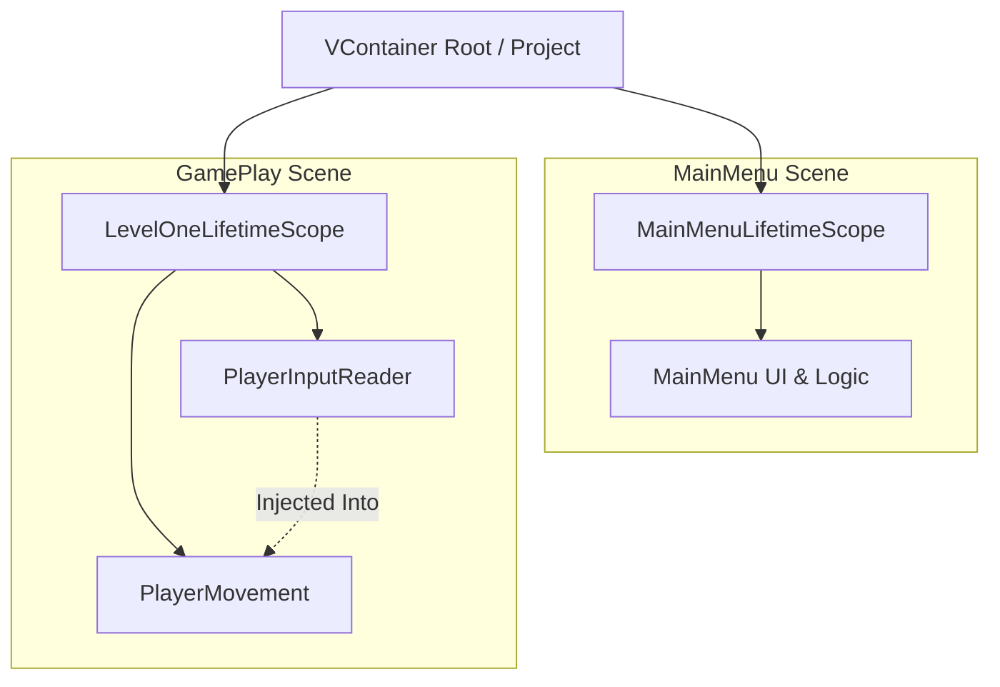
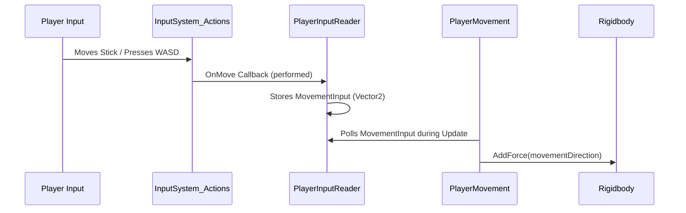

# Architecture & Design Patterns

This document describes the architectural philosophy, dependency injection structure, lifecycle management, and communication patterns used in the **Dev3PracticalExam** project.

---

## 1. Dependency Injection Architecture (VContainer)

The project utilizes **VContainer** (`jp.hadashikick.vcontainer`) for decoupling gameplay dependencies.

### Scopes & Hierarchy



### Lifetime Scopes

1. **`LevelOneLifetimeScope` (`Assets/Project/Scripts/LevelOneLifetimeScope.cs`)**:
   - Manages dependencies for the `GamePlay` scene.
   - Registers components in `Configure(IContainerBuilder builder)`:
     ```csharp
     builder.RegisterComponent(playerMovement);
     builder.RegisterComponent(playerInputReader);
     ```

2. **`MainMenuLifetimeScope` (`Assets/Project/Scripts/MainMenuLifetimeScope.cs`)**:
   - Scene-level scope for the start menu.
   - Available for registering menu controllers or UI view models as the menu expands.

### Injection Pattern

The project primarily uses **Method Injection** via the `[Inject]` attribute on MonoBehaviours:

```csharp
public class PlayerMovement : MonoBehaviour
{
    private PlayerInputReader inputReader;

    [Inject]
    public void Construct(PlayerInputReader playerInputReader)
    {
        inputReader = playerInputReader;
    }
}
```

**Why this matters for agents:**
- Do **not** use `FindObjectOfType<PlayerInputReader>()` or `GetComponent<PlayerInputReader>()` across game objects.
- When introducing new dependencies to `PlayerMovement` (or new controllers), add parameters to `Construct(...)` and register them in `LevelOneLifetimeScope`.

---

## 2. Hybrid Singleton & Scoped Architecture

The project balances modern DI with pragmatic Unity patterns:

| Pattern | Components | Lifecycle | Rationale |
| :--- | :--- | :--- | :--- |
| **VContainer Scoped** | `PlayerMovement`, `PlayerInputReader` | Bound to `GamePlay` scene | Clean teardown on scene reload; prevents dangling scene references. |
| **Persistent Singleton** | `SoundManager` | `DontDestroyOnLoad` | BGM and persistent sound effects must continue uninterrupted across scene transitions. |
| **Scene Monobehaviour** | `GameSettingsManager`, `ScenesManager`, `ClickableText` | Scene-bound | UI presentation and event dispatching. |

---

## 3. Communication Patterns

### Input Decoupling



1. **Input Asset -> Reader**: `PlayerInputReader` registers to `MoveAction.action.performed` and `canceled`.
2. **Reader -> Consumer**: `PlayerMovement` polls the sanitized `MovementInput` property. Physics is isolated from raw input devices.
3. **Action Map Switching**: `InputManager` acts as the coordinator between `Player` and `UI` action maps, disabling gameplay inputs when menus are active.

### UI Interaction & Tweening

- UI events are handled declaratively via `ClickableText.cs`.
- Uses Unity UI event interfaces: `IPointerClickHandler`, `IPointerEnterHandler`, `IPointerExitHandler`, and `IScrollHandler`.
- Animates visual feedback through `LeanTween` rather than Unity Animator state machines, keeping UI components lightweight and performant.
- Triggers audio feedback via `SoundManager.Instance.PlaySFX(...)` and dispatches actions through serialized `UnityEvent`s.

---

## 4. State Persistence

- Audio and graphics settings use `PlayerPrefs` for local persistent storage.
- Loaded on `Awake()` / `Start()` by `AudioSettings.cs` and `GameSettingsManager.cs`.
- Real-time updates occur immediately when UI sliders/text items are adjusted, saving changes synchronously.
