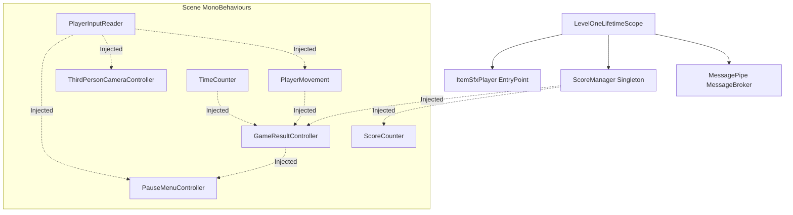
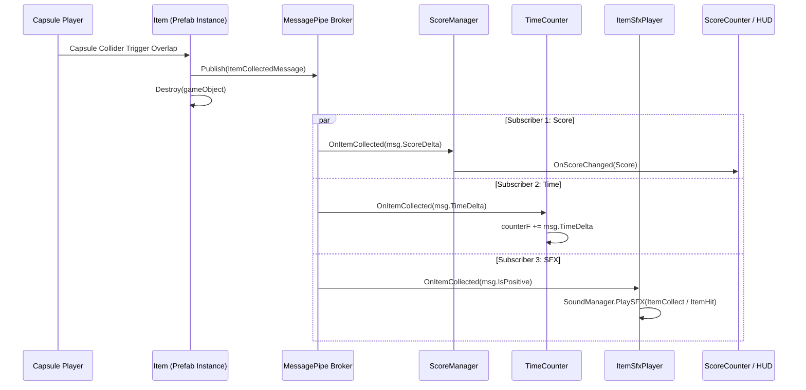
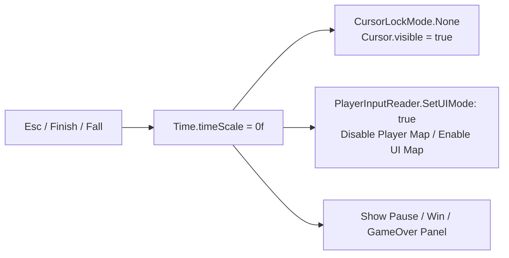

# Architecture & Design Patterns

This document describes the architectural philosophy, dependency injection structure, in-memory messaging pipeline, lifecycle management, and communication patterns used in the **Dev3PracticalExam** project.

---

## 1. Dependency Injection Architecture (VContainer)

The project utilizes **VContainer** (`jp.hadashikick.vcontainer`) as its central Dependency Injection container.

### Scope Configuration (`LevelOneLifetimeScope.cs`)

The `GamePlay` scene (Stage 1) is orchestrated via `LevelOneLifetimeScope`:

```csharp
public class LevelOneLifetimeScope : LifetimeScope
{
    [SerializeField] private PlayerMovement playerMovement;
    [SerializeField] private PlayerInputReader playerInputReader;
    [SerializeField] private ThirdPersonCameraController thirdPersonCameraController;
    [SerializeField] private TimeCounter timeCounter;
    [SerializeField] private ScoreCounter scoreCounter;
    [SerializeField] private GameResultController gameResultController;
    [SerializeField] private PauseMenuController pauseMenuController;
    
    protected override void Configure(IContainerBuilder builder)
    {
        // 1. Scene MonoBehaviours
        builder.RegisterComponent(playerMovement);
        builder.RegisterComponent(playerInputReader);
        builder.RegisterComponent(thirdPersonCameraController);
        builder.RegisterComponent(timeCounter);
        builder.RegisterComponent(scoreCounter);
        builder.RegisterComponent(gameResultController);
        builder.RegisterComponent(pauseMenuController);

        // 2. MessagePipe Event Pipeline
        MessagePipeOptions options = builder.RegisterMessagePipe();
        builder.RegisterMessageBroker<ItemCollectedMessage>(options);

        // 3. Domain Services & EntryPoints
        builder.Register<ScoreManager>(Lifetime.Singleton);
        builder.RegisterEntryPoint<ItemSfxPlayer>();

        // 4. Dynamic Scene Item Injection
        builder.RegisterBuildCallback(container =>
        {
            foreach (Item item in FindObjectsByType<Item>(FindObjectsInactive.Include, FindObjectsSortMode.None))
            {
                container.Inject(item);
            }
        });
    }
}
```

### Dependency Graph



---

## 2. Event-Driven Messaging Architecture (MessagePipe)

To decouple placed stage items from the scoring, timing, and audio systems, the project integrates **MessagePipe** (`com.cysharp.messagepipe`).

### Data Flow Diagram



### Key Message: `ItemCollectedMessage`
- `ItemType Type`: Identifies the item (`TimeBoost`, `ScoreBoost`, `TimePenalty`, `ScorePenalty`).
- `int ScoreDelta`: $+500$ for positive boost, $-500$ for penalty.
- `float TimeDelta`: $+3\text{s}$ for boost, $-5\text{s}$ for penalty.
- `bool IsPositive`: Helper determining whether positive or obstacle sound effect is played.

---

## 3. ScriptableObject Stats Architecture

To allow live game design tuning without modifying code or restarting play mode, player movement and camera controls are decoupled into ScriptableObjects:

| Stats Asset | Class | Responsibility |
| :--- | :--- | :--- |
| **`PlayerMovementStats`** | `Assets/Project/Scripts/Player/PlayerMovementStats.cs` | Move speed (`6`), run speed (`10`), jump height (`2m`), gravity multipliers (`fall: 2x`, `lowJump: 2.5x`), coyote time (`0.1s`), jump buffer (`0.1s`), air control (`0.5`), ground check distance/radius/mask. |
| **`ThirdPersonCameraSettings`** | `Assets/Project/Scripts/Camera/ThirdPersonCameraSettings.cs` | Look sensitivity (`0.12`), pitch bounds (`-30°` to `+70°`), pivot offset, camera distance (`5m`), shoulder offset, damping, collision filter mask. |

---

## 4. Time-Scale & Pause Architecture

When pausing or concluding the game, multiple subsystems coordinate:



1. **`Time.timeScale = 0f`**: Halts `Update()` deltas, physics simulations, and the countdown clock.
2. **Cursor Management**: Unlocks and displays the mouse cursor for UI button clicks.
3. **Action Map Switching**: `PlayerInputReader.SetUIMode(true)` disables the `Player` action map (resetting movement, look, run, and jump inputs) while enabling the `UI` action map.
4. **Resuming / Retrying**: Restores `Time.timeScale = 1f`, relocks the cursor, and re-enables gameplay inputs.

---

## 5. Architectural Conventions Summary

- **MonoBehaviour Injection**: Always use `[Inject] public void Construct(...)`.
- **Pure C# Services**: Registered in LifetimeScope with `Lifetime.Singleton` or `Lifetime.Scoped`.
- **Cross-Cutting Events**: Use MessagePipe `IPublisher<T>` and `ISubscriber<T>`, avoiding direct GameObject references or static singletons.
- **Audio Singleton**: `SoundManager.Instance` with `DontDestroyOnLoad` handles continuous BGM and transient sound effects.
